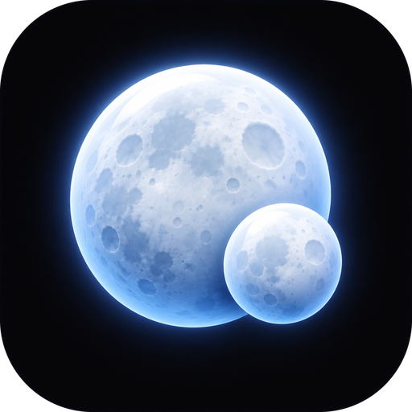

# moons brand

| | |
| --- | --- |
| Name | moons (lowercase in text and UI) |
| Ticker | $MOONS |
| Pitch | every coin that trades against yours. |
| npm | `moons-cli` (command: `moons`) |

## The mark

 &nbsp; 

A big moon with a small moon in front of it: your token, and the coins paired against it in orbit.

The 3D app icon is the main brand. The flat mark is for small sizes (under 32px) and one-colour use.

Files in `assets/`:

- `icon.png`: 512x512 3D app icon with rounded corners, transparent outside. Use it for nav, lockups and avatars.
- `logo.svg`: flat mark in the accent `#8DB8FF`, transparent background.
- `logo-mono.svg`: flat mark in `currentColor`, for favicons, print and one-colour contexts.
- `coin.png`: 1000x1000 full bleed token image for $MOONS, reads fine cropped to a circle.
- `docs/preview.png`: 1440x900 website shot with the tool and a report (example data), used as the OG image.
- `banner.png`: 1280x640 social preview. Source: `banner.html` (uses `fonts/` and `icon.png`).
- `terminal.svg`, `dashboard.png`, `graph.svg`: product shots from real runs against the mock API (example data).

The full kit (favicons, lockups, X banner, OG image, logo sheet) lives outside the repo in the brand folder.

## Palette

Deep space navy, not neutral black.

| Role | Hex | Use |
| --- | --- | --- |
| Background | `#060A14` | Page and image backgrounds |
| Panel | `#0B1222` | Cards, terminal windows, the search pill |
| Raised | `#111A2E` | Inputs, chips, hover, gauge track |
| Line | `rgba(141,184,255,.12)` | Borders, dividers, orbit rings |
| Text | `#E8EEF9` | Primary text |
| Muted | `#7D8BA6` | Labels, captions |
| Accent | `#8DB8FF` | Ice blue. The action, the key number (flow), the mark |
| Up | `#3DDC84` | Price and score going up |
| Down | `#FF5F6D` | Price and score going down |

## Typography

- **Geist** (variable) for UI and headings, weight 600 on headings, tracking -0.04em on big type.
- **Geist Mono** for every number, address, code block and CLI line.
- Wordmark: `moons` in Geist 600, lowercase, tracking -0.04em. Never all caps.
- Fonts ship in the repo: `src/fonts/` (served by the dashboard), `docs/fonts/` (landing page), `assets/fonts/` (banner source).

## Shapes

- Pill buttons, inputs and tags (999px radius). Panels are 20px radius with a 1px line.
- Thin orbit rings and a faint star-dot texture as decoration. Centred, airy layouts.

## Logo usage

- Use the 3D icon at 32px and up. Under 32px use the flat mark.
- Keep clear space around the icon of at least 25% of its width.
- Do not recolour, stretch, rotate, outline or put the icon on a busy photo.
- The flat mark goes in ice blue on navy, `#060A14` on light, or white on any other dark colour.

## Voice

- Say what it does with a number: "6 pairs, $417K est. flow back, health 62/100".
- Short, lowercase, like a dev posting on CT. No press release words.
- Estimates are called estimates. Example data is labelled. Not financial advice.
