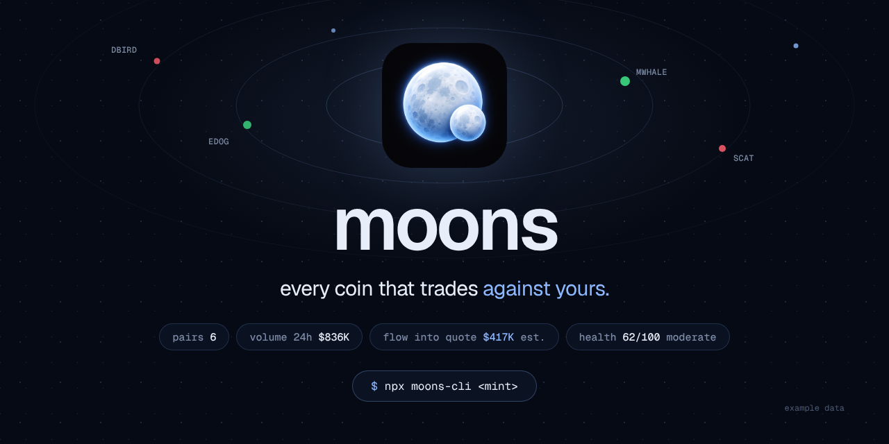
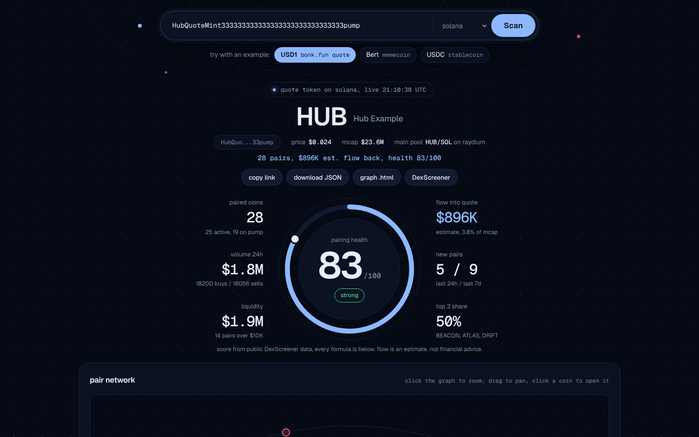
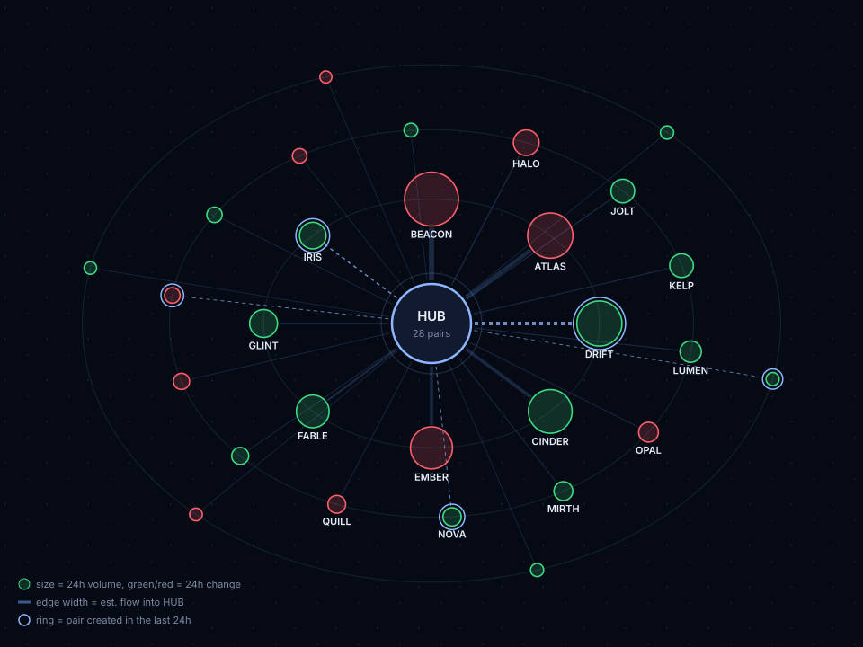
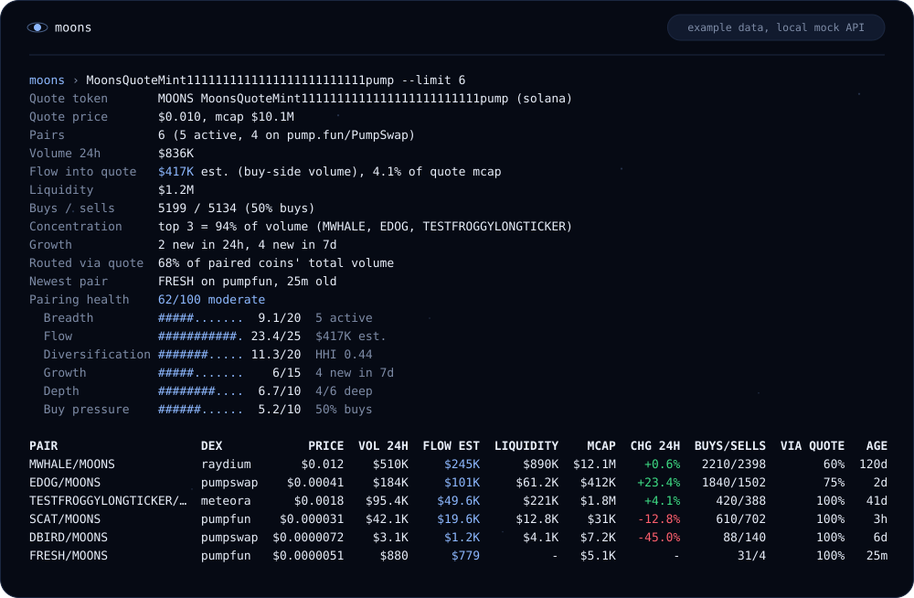
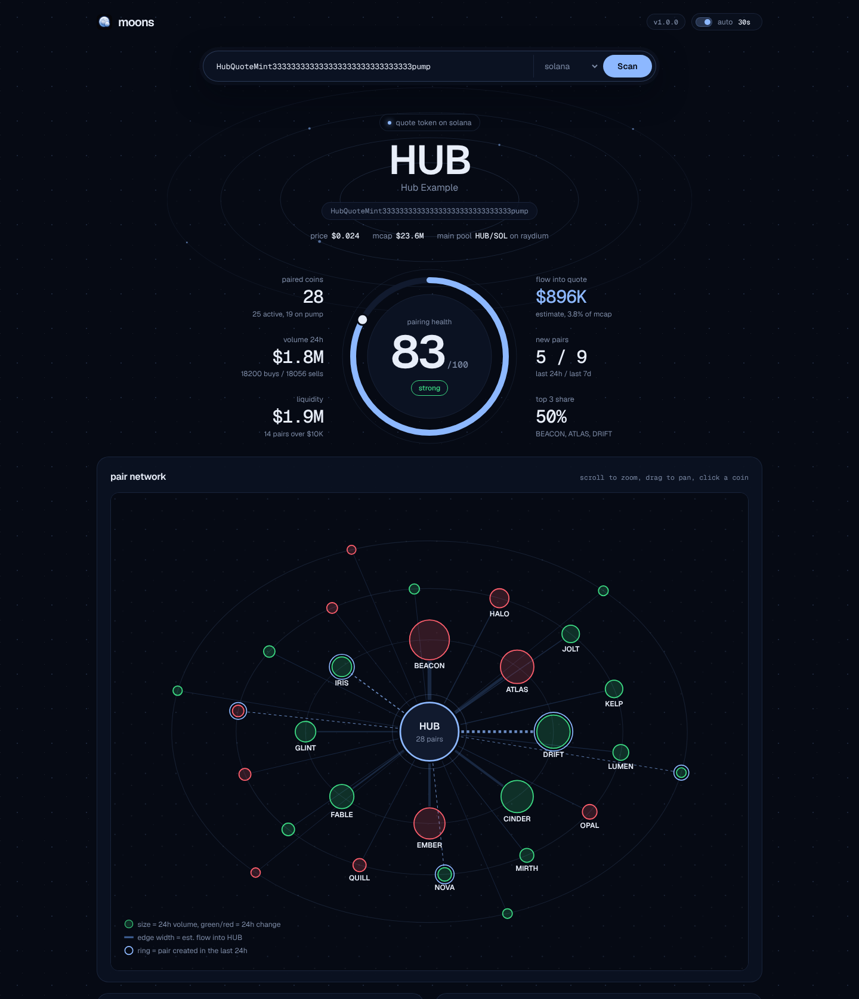
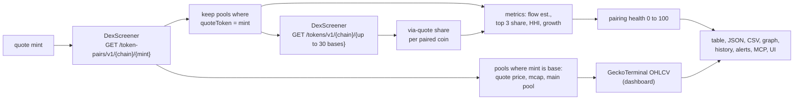

<p align="center">
  
</p>

<p align="center">
  <br>
  <b>moons</b><br>
  every coin that trades against yours.
</p>

<p align="center">
  <a href="LICENSE"></a>
  <a href="https://nodejs.org">= 18"></a>
  <a href="package.json"></a>
  <a href="#use-it-from-an-ai-agent"></a>
</p>

<p align="center">
  <a href="https://moonscli.com"><b>moonscli.com</b></a> &nbsp;·&nbsp;
  <a href="#install">install</a> &nbsp;·&nbsp;
  <a href="#quick-start">quick start</a> &nbsp;·&nbsp;
  <a href="#commands-and-flags">commands</a> &nbsp;·&nbsp;
  <a href="#dashboard">dashboard</a> &nbsp;·&nbsp;
  <a href="#use-it-from-an-ai-agent">mcp</a> &nbsp;·&nbsp;
  <a href="#use-it-as-a-library">library</a> &nbsp;·&nbsp;
  <a href="#faq">faq</a>
</p>

## Use it in your browser

**[moonscli.com](https://moonscli.com)**: paste any token address, pick the chain (Solana by default) and get the full ecosystem report live: pairing health ring, estimated flow into the quote token, the interactive pair network graph, new pairs, flow leaders with the GeckoTerminal price line and a sortable table of every pair. Nothing to install, no wallet, no key.

- Runs the exact code of the CLI (`src/` is copied to `docs/lib/`, a test keeps the copies identical).
- Your browser calls DexScreener and GeckoTerminal directly. There is no moons server in between, so there are no serverless functions and no environment variables for the site.
- Share a report with `https://moonscli.com/?token=<address>` (add `&chain=base` for other chains). The page runs it on load.
- Pasting a pump.fun, DexScreener or explorer link works too; the address is pulled out of it.
- "try with an example" loads USD1 (the quote token of bonk.fun launches), Bert (a memecoin other coins pair against) or USDC.

<p align="center"></p>

The screenshot shows example data from the local mock API.

## Why moons

Launchpads pair new coins against their own token instead of SOL. Every buy of one of those coins spends the quote token first, so the coins paired against your token are its moons: they orbit it and send flow back to it from pools you never made.

moons finds them. Give it a token address and it lists every pool where that token is the **quote** side, then puts numbers on the set: estimated buy flow back into your token, how concentrated it is, how many new pairs showed up this week, and a pairing health score from 0 to 100 with every formula published. Public DexScreener data, no API key, zero runtime dependencies.

## Install

Run it without installing:

```sh
npx moons-cli <mint>
```

Or install it globally (the npm package is `moons-cli`, the command is `moons`):

```sh
npm install -g moons-cli
moons <mint>
```

Node.js 18 or newer. No API keys.

## Quick start

```sh
# every pair quoted in your token, on Solana
moons <mint>

# rank by estimated flow, skip dust pools
moons <mint> --sort flow --min-liquidity 1000

# interactive pair graph
moons <mint> --graph moons.html

# two launchpad tokens side by side
moons compare <mintA> <mintB>

# poll every minute, keep history, ping Discord on new pairs and when flow crosses $250K
moons <mint> --watch 60 --history moons.json \
  --alert-webhook https://discord.com/api/webhooks/... --alert-flow 250000

# growth over time from the stored snapshots
moons history --history moons.json

# local dashboard
moons ui
```

### Compare (example data)

```text
$ moons compare MoonsQuoteMint1111111111111111111111111pump PadQuoteMint22222222222222222222222222222pump
MOONS  MoonsQuoteMint1111111111111111111111111pump (solana), health 62/100 moderate
PAD    PadQuoteMint22222222222222222222222222222pump (solana), health 63/100 moderate

METRIC                     MOONS       PAD
Health score                62        63 *
Pairs                        6 *       4
Active pairs                 5 *       4
Volume 24h               $836K *   $256K
Flow into quote (est.)   $417K *   $143K
Liquidity                $1.2M *   $205K
New pairs 24h                2         2
New pairs 7d                 4 *       3
Top 3 share                94%       91%
Buy ratio                  50%       56% *

* leader on that metric. Flow is an estimate: 24h volume x buys / (buys + sells).
```

### History (example data)

Two runs six hours apart with `--history moons-history.json`. Between them two new pairs appeared on the mock API, so the second run printed a delta line and, with `--alert-flow 400000`, sent one webhook with two events.

```text
$ moons MoonsQuoteMint1111111111111111111111111pump --history moons-history.json --limit 3 --alert-webhook <url> --alert-flow 400000
...
Since 2026-10-14 06:00 UTC: pairs +2, volume +$43K, flow +$20.4K, health +4, 2 new, 0 gone
moons: alert to webhook sent (2 event(s))

$ moons history --history moons-history.json
MOONS (solana), 2 snapshots, 2026-10-14 06:00 to 2026-10-14 12:00 UTC
TIME (UTC)        PAIRS  NEW  VOL 24H  FLOW EST  LIQUIDITY  HEALTH
2026-10-14 06:00      4    -    $793K     $397K      $1.2M      58
2026-10-14 12:00      6   +2    $836K     $417K      $1.2M      62
Growth: pairs +2, volume +$43K, flow +$20.4K, liquidity +$12.8K, health +4, 6 unique pairs seen
```

The webhook body from that run (Discord reads `content`, everything else is in `moons`):

```json
{
  "content": "moons: MOONS (solana)\n2 new pairs:\n+ SCAT/MOONS on pumpfun, vol $42.1K, liq $12.8K, https://dexscreener.com/solana/PairBBB...\n+ FRESH/MOONS on pumpfun, vol $880, liq -, https://dexscreener.com/solana/PairFFF...\nEst. flow into quote 24h crossed above $400K: $397K to $417K",
  "username": "moons",
  "moons": {
    "mint": "MoonsQuoteMint1111111111111111111111111pump",
    "chain": "solana",
    "symbol": "MOONS",
    "at": "2026-10-14T12:00:00.000Z",
    "health": 62,
    "flowUsd": 417179,
    "events": [
      { "type": "new_pairs", "count": 2, "pairs": [ { "pairAddress": "PairBBB...", "baseSymbol": "SCAT", "dexId": "pumpfun", "volume24h": 42110, "liquidityUsd": 12800, "url": "..." } ] },
      { "type": "threshold", "metric": "flow", "label": "Est. flow into quote 24h", "threshold": 400000, "direction": "up", "from": 396821, "to": 417179 }
    ]
  }
}
```

(Addresses shortened with `...` here; the real payload has full values.)

### Network graph (example data)

`moons <mint> --graph out.svg` on the 28-pair demo fixture. The `.html` variant adds tooltips, click-through to DexScreener, scroll zoom and drag pan.

<p align="center"></p>

## See it run

Example data. This is a real run of moons against the local mock API in `scripts/mock-server.js`, which serves the fixtures in `test/fixtures/`. The tokens are made up.

<p align="center"></p>

## What you get

| | Feature | What you get |
| --- | --- | --- |
| **Report** | Ecosystem report | Paired coins with volume, liquidity, market cap, age, buys/sells, 24h change and estimated flow into the quote token |
| **Flow** | Flow into quote | Buy-side volume per pair, `volume.h24 x buys / (buys + sells)`, summed and compared with the quote token's market cap. Always labelled as an estimate |
| **Health** | Pairing health 0 to 100 | Breadth, flow, diversification, growth, depth and buy pressure, each with a published formula |
| **Routing** | Via quote share | Batch lookup of each paired coin's other pools: how much of its total volume trades through your token |
| **Compare** | `moons compare` | Two to five quote tokens side by side, leaders marked |
| **History** | `--history` and `moons history` | Snapshots in a local JSON file, deltas between runs, growth over time |
| **Alerts** | Webhook and Telegram | New pairs and threshold crossings to Discord-compatible webhooks (content plus JSON payload) and the Telegram Bot API |
| **Graph** | `--graph out.html` or `.svg` | Network graph: quote token in the centre, paired coins sized by volume, edges by flow. Self-contained HTML with zoom, pan and tooltips, or a static SVG |
| **Dashboard** | `moons ui` | Local single-page dashboard: health ring with the key numbers around it, network graph, flow leaders, new pairs, sortable table, auto refresh |
| **MCP** | `moons mcp` | Four tools for Claude Desktop, Claude Code, Cursor and any other MCP client |

## Commands and flags

```text
moons <mint> [options]              Ecosystem report for a quote token
moons compare <mintA> <mintB> ...   Side by side ecosystems (2 to 5 tokens)
moons history [--history file]      Growth over time from stored snapshots
moons ui [--port 4646]              Local dashboard
moons mcp                           MCP server on stdio for AI agents
```

| Flag | Default | Description |
| --- | --- | --- |
| `--chain <id>` | `solana` | DexScreener chain id, for example `solana`, `base`, `bsc`, `ethereum`. |
| `--sort <key>` | `volume` | `volume`, `flow`, `liquidity`, `mcap`, `age` (newest first) or `change`. |
| `--min-liquidity <usd>` | `0` | Hide pairs with less USD liquidity. Unknown liquidity counts as 0. |
| `--limit <n>` | `50` (history: `20`) | Rows to print, `0` for all. Metrics always use every pair. |
| `--json` / `--csv` | off | Machine readable output. `--json` includes metrics, health, quote info and the delta. |
| `--skip-routing` | off | Skip the `/tokens/v1` batch lookup that computes the via-quote share. |
| `--graph <file>` | | Write the network graph. `.html` is interactive, `.svg` is static. |
| `--watch <seconds>` | off | Poll every N seconds (minimum 5), mark new pairs, print deltas. Stop with Ctrl+C. |
| `--history <file>` | | Append a snapshot per run or poll to a JSON file. The previous snapshot is used for deltas and alerts, also across restarts. |
| `--alert-webhook <url>` | `$MOONS_WEBHOOK` | POST alerts as `{ content, username, moons }`. Works with Discord webhooks. |
| `--telegram-token <token>` | `$MOONS_TELEGRAM_TOKEN` | Telegram bot token for `sendMessage`. |
| `--telegram-chat <id>` | `$MOONS_TELEGRAM_CHAT` | Telegram chat id. Required with a token. |
| `--alert-flow <usd>` | | Alert when estimated flow into the quote crosses this value, up or down. |
| `--alert-volume <usd>` | | Alert when ecosystem 24h volume crosses this value. |
| `--alert-health <score>` | | Alert when the health score crosses this value. |
| `--alert-pairs <n>` | | Alert when the number of paired coins crosses this value. |
| `--mint <address>` | | `history` only: show one token. |
| `--port <n>` | `4646` | `ui` only: port. The server binds to 127.0.0.1. |
| `--refresh <seconds>` | `30` | `ui` only: auto refresh interval (minimum 5). |
| `--api <url>` | `https://api.dexscreener.com` | DexScreener base URL. |
| `--gecko-api <url>` | `https://api.geckoterminal.com/api/v2` | GeckoTerminal base URL. |
| `-h`, `--help` / `-v`, `--version` | | Help and version. |

Alerts need a previous reading: the first run with a new `--history` file, or the first poll of `--watch` without one, stores a baseline and sends nothing. New pair alerts fire for pairs that were not in the previous snapshot. Threshold alerts fire once per crossing, not on every run above the line.

Exit codes: `0` success (also when no pairs are found), `1` API or file error, `2` invalid arguments.

## Dashboard

```sh
moons ui            # http://127.0.0.1:4646
moons ui --port 8080 --refresh 60
```

One HTML page with inline CSS and JS, served by `node:http`. Paste a mint into the search pill and you get the quote token up top, the pairing health ring with six key numbers around it, the network graph, the health breakdown, flow leaders with the quote price line, new pairs and a sortable table of every pair. It refreshes on an interval and highlights pairs that appeared since the previous refresh. The quote token's price line comes from GeckoTerminal hourly candles of its most liquid pool. Open `http://127.0.0.1:4646/?mint=<address>` to link straight to a token.

JSON endpoints: `GET /api/report?mint=&chain=&minLiquidity=` and `GET /api/health`.

<p align="center"></p>

The screenshot shows example data from the 28-pair demo fixture.

## Use it from an AI agent

`moons mcp` starts a [Model Context Protocol](https://modelcontextprotocol.io) server over stdio (JSON-RPC 2.0, one message per line, logs on stderr). Add it to Claude Desktop (`claude_desktop_config.json`), Claude Code (`.mcp.json`) or Cursor:

```json
{
  "mcpServers": {
    "moons": {
      "command": "npx",
      "args": ["-y", "moons-cli", "mcp"]
    }
  }
}
```

With Claude Code you can also run `claude mcp add moons -- npx -y moons-cli mcp`.

| Tool | Arguments | Returns |
| --- | --- | --- |
| `scan_pairs` | `mint`, `chain?`, `sort?`, `min_liquidity?`, `limit?` | Pools where the token is the quote side, with flow estimates |
| `ecosystem_report` | `mint`, `chain?`, `min_liquidity?`, `limit?` | Metrics, health score with components, quote token info and top pairs |
| `compare_tokens` | `mints` (2 to 5), `chain?` | Side by side metrics with the leader per metric |
| `new_pairs_since` | `mint`, `since?` (`24h`, `7d`, ISO date or unix time), `chain?` | Pairs created after the cutoff, newest first |

Example prompt: "use moons to compare these two launchpad tokens and tell me which one gets more buy flow from its pairs."

## Use it as a library

```js
import { ecosystemReport, newPairsSince, renderGraphHtml } from 'moons-cli';
import { writeFileSync } from 'node:fs';

const mint = 'MoonsQuoteMint1111111111111111111111111pump';
const report = await ecosystemReport(mint, { chain: 'solana', minLiquidity: 0 });
console.log(report.health.score, report.health.grade);   // 62 'moderate'
console.log(Math.round(report.metrics.flowUsd));         // 417179 (estimate)

const fresh = await newPairsSince(mint, '24h');
console.log(fresh.pairs.map((p) => p.baseSymbol));       // [ 'FRESH', 'SCAT' ]

writeFileSync('moons.html', renderGraphHtml(report));
```

The values in the comments come from a run against the mock API (`MOONS_API=http://127.0.0.1:8787`).

| Export | Purpose |
| --- | --- |
| `ecosystemReport(mint, opts)` | Full report: `quote`, `metrics`, `health`, `flowToMcap`, `pairs` |
| `compareTokens(mints, opts)` | Reports for 2+ tokens plus a metric table with leaders |
| `newPairsSince(mint, since, opts)` | Pairs created after a duration, date or timestamp |
| `scanPairs(mint, opts)` | The 0.1.0 scan: summary plus sorted pairs |
| `quotePriceHistory(mint, opts)` | GeckoTerminal OHLCV for the quote token's main pool |
| `computeMetrics(rows)`, `healthScore(metrics)` | The analytics on their own |
| `recordSnapshot(file, report)`, `historySeries(history)` | History file helpers |
| `buildAlerts(...)`, `sendAlerts(events, report, opts)` | Alert events and delivery |
| `renderGraphSvg(report)`, `renderGraphHtml(report)` | Graph export |
| `fetchTokenPairs`, `fetchTokensBatch`, `fetchOhlcv` | Raw API clients with retry and cache |

Common options: `chain`, `apiBase`, `geckoBase`, `retries` (4), `baseDelay` (500 ms), `timeout` (15000 ms), `cacheTtl` (15000 ms for DexScreener reads), `fetchImpl`. Subpath exports: `moons-cli/format`, `moons-cli/graph`, `moons-cli/mcp`, `moons-cli/server`.

## How the numbers work



**Flow into quote (estimate).** For each pair quoted in your token, buy-side volume is approximated as `volume.h24 x buys / (buys + sells)` using DexScreener's 24h transaction counts. Every buy of a coin quoted in your token spends your token, so the buyer had to hold or buy it first. Trade sizes differ between buys and sells, routers can split trades, and some buyers already hold the quote token, so treat the number as an order of magnitude, not an accounting figure.

**Pairing health.** Six components, rounded sum out of 100:

| Component | Max | Formula |
| --- | --- | --- |
| Breadth | 20 | active pairs (24h volume >= $1K), `log10(1 + n) / log10(51)`, full at 50 |
| Flow | 25 | estimated flow, `log10(1 + flow) / 6`, full at $1M per 24h |
| Diversification | 20 | `1 - HHI` of 24h volume shares |
| Growth | 15 | pairs created in the last 7 days, full at 10 |
| Depth | 10 | share of pairs with liquidity >= $10K |
| Buy pressure | 10 | `(buy ratio - 0.4) / 0.2`, so 40% buys scores 0 and 60% or more scores full |

Grades: 70 and up strong, 40 to 69 moderate, below 40 weak. The report also shows the top 3 share of volume, new pairs in 24h and 7d, and the via-quote share (paired coins' volume in your pairs divided by their volume across all their pools on that chain).

**Networking.** Requests that fail with 429, 5xx or a network error are retried with exponential backoff (0.5s, 1s, 2s, 4s). A `Retry-After` header, in seconds or as an HTTP date, takes precedence (capped at 60 seconds). DexScreener reads are cached in memory for 15 seconds (the CLI report and watch mode always fetch fresh). GeckoTerminal calls go through a limiter of 30 per minute. A report uses one `token-pairs` request plus one `tokens` request per 30 paired coins.

**Limits.** moons only sees what DexScreener indexes, and the `token-pairs` endpoint may cap the number of pools it returns for widely traded tokens. Ages come from `pairCreatedAt`.

## Environment variables

| Variable | Purpose |
| --- | --- |
| `MOONS_API` | DexScreener base URL (mocks, caching proxies) |
| `MOONS_GECKO_API` | GeckoTerminal base URL |
| `MOONS_TELEGRAM_API` | Telegram Bot API base URL (default `https://api.telegram.org`) |
| `MOONS_WEBHOOK` | Default for `--alert-webhook` |
| `MOONS_TELEGRAM_TOKEN` | Default for `--telegram-token`, keeps the token out of shell history |
| `MOONS_TELEGRAM_CHAT` | Default for `--telegram-chat` |
| `NO_COLOR` | Disable ANSI colours (also off when stdout is not a TTY) |

## FAQ

**Is "flow into quote" the amount of my token that was bought?**
No. It is an estimate of the USD value of buys in pairs quoted in your token over 24h. It assumes buys and sells have the same average size. Use it to compare ecosystems and track direction over time.

**Why is my token missing pairs I know exist?**
DexScreener has to index the pool and its DEX. Some endpoints cap results for very active tokens. moons also drops pools where your token is the base side; those show up as the quote token's own price pools.

**Does it work on EVM chains?**
Yes. Pass `--chain base`, `--chain bsc` and so on. `0x` addresses are matched case-insensitively.

**How often can I poll?**
The minimum `--watch` interval is 5 seconds. A report costs one DexScreener request plus one per 30 paired coins; DexScreener documents 300 requests per minute for these endpoints. Use `--skip-routing` to skip the batch requests.

**Where is my data stored?**
Only in the `--history` file you choose. Nothing is sent anywhere except the API calls and the alert targets you configure.

**Why "moons"?**
Coins paired against your token orbit it: every buy of one of them goes through your token first. moons maps that orbit.

**Why does a big token show few or no pairs on the site?**
DexScreener's `token-pairs` endpoint returns up to 30 pools per token, most liquid first. For a large token those are mostly its own pools against SOL or USDC, so smaller coins paired against it fall off the list. Launchpad quote tokens and coins that other coins pair against work best.

**Is this trading advice?**
No. moons reports public market data and estimates. Not financial advice.

## Roadmap

- [ ] `--chain all` to scan the same quote token across several chains in one report.
- [ ] Per-DEX and per-launchpad breakdown of volume and flow.
- [ ] Use `txns.h1` and `volume.h1` for a short-window flow estimate next to the 24h one.
- [ ] Health score history chart in the dashboard from the `--history` file.
- [ ] Slack-formatted webhook payload option.
- [ ] `moons export` to write history as CSV.

## Contributing

Issues and PRs welcome. The test suite runs offline against the local mock API:

```sh
npm test
npm run mock      # mock DexScreener, GeckoTerminal, webhook and Telegram on :8787
npm run assets    # regenerate terminal.svg, graph.svg and the docs demo blocks from real runs
npm run site      # the website on http://127.0.0.1:5173 plus the mock API, prints a ready link
```

The website lives in `docs/` (static, deployed by Vercel with no build step, see `vercel.json`). `docs/app.js` is the browser code; `docs/lib/` holds byte for byte copies of `src/client.js`, `core.js`, `ecosystem.js`, `format.js`, `graph.js` and `ohlcv.js`. After changing one of those, copy it again (`cp src/core.js docs/lib/`), `test/site.test.js` fails until you do. On localhost the page accepts `?api=http://127.0.0.1:PORT` to read the mock API instead of DexScreener; production ignores it. `test/site.e2e.test.js` drives the page in headless Chromium when Playwright is available (`PLAYWRIGHT_MODULE=/path/to/playwright/index.mjs`) and skips otherwise.

See [CONTRIBUTING.md](CONTRIBUTING.md), [CODE_OF_CONDUCT.md](CODE_OF_CONDUCT.md) and [SECURITY.md](SECURITY.md). Brand guidelines are in [BRAND.md](BRAND.md).

## License

[MIT](LICENSE). Market data from DexScreener and GeckoTerminal. Not financial advice.
